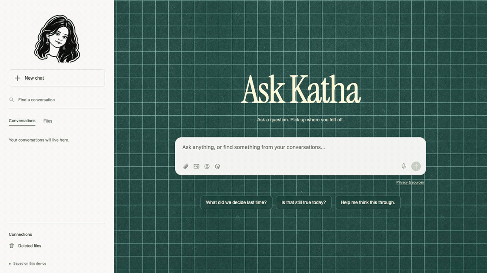
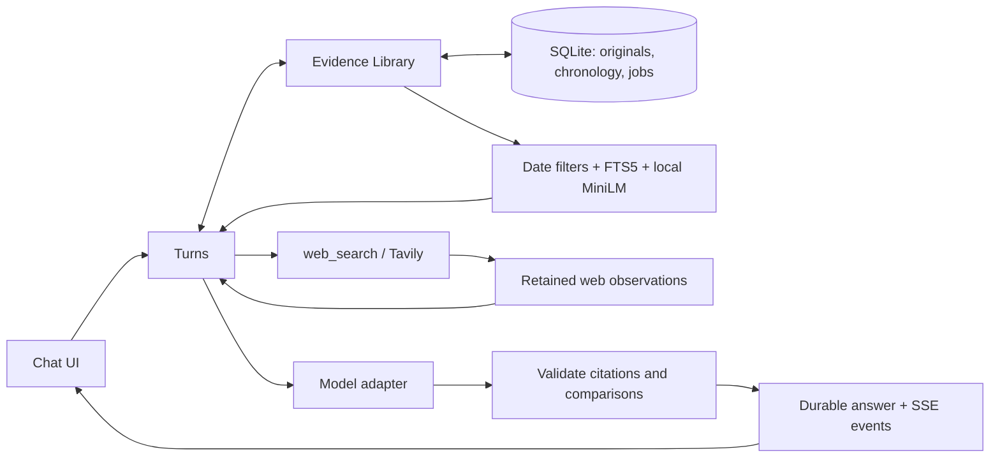

# Ask Katha

**Remember the record. Verify the change.**

Katha is a local-first chat agent built for the **MiniMi hiring challenge**. It tackles questions that need both memory and fresh evidence:

> “On Monday we shortlisted five CRMs. Has anything changed since?”

The hard part is choosing the right Monday, recovering the original shortlist, and separating a documented change from a current difference whose timing is unknown. Katha makes those steps inspectable.



*Recorded from the running app with a real model and synthetic chat content. Typing and pauses are edited for readability; this is not a latency benchmark.*

**Start here:** [one-page DESIGN.md](DESIGN.md) · [core interfaces](src/core/types.ts) · [judge-style tests](tests/judge-conversations.test.ts) · [latest attachment audit](docs/evaluations/multimodal-2026-11-16.md).

## Quickstart

Use **Node.js 24 LTS** and a normal local clone. No external SSD, Docker, or hosted database is required.

```sh
git clone https://github.com/somuai/katha.git
cd katha
npm install
cp .env.example .env
```

On Windows, copy `.env.example` to `.env` in your editor or use `Copy-Item .env.example .env` in PowerShell.

Add your keys to the root `.env`:

```dotenv
GROQ_API_KEY=your_groq_key
TAVILY_API_KEY=your_tavily_key
```

```sh
npm run dev
```

Open **http://localhost:3000**. Keep keys on the server; never commit `.env`.

| Configuration | Purpose |
| --- | --- |
| `GROQ_API_KEY` | Model answers, image/scanned-page interpretation and voice transcription |
| `TAVILY_API_KEY` | The agent's web-search tool |
| `GROQ_MODEL` | Defaults to `qwen/qwen3.8-27b`; configurable because provider availability can change |
| `KATHA_EMBEDDINGS=off` | Optional lexical-only startup without downloading local embedding weights |
| `KATHA_DATA_DIR` | Optional workspace location; defaults to ignored `data/` |

Semantic memory downloads MiniLM weights on first use. Original text and lexical recall are available before enrichment finishes. Without provider keys, Katha still saves records and supports deterministic dated recall, but model answers and live search are unavailable. Free provider plans have quotas; “free” does not mean unlimited. Gemini and account-connection credentials are optional, not required to evaluate the core agent.

## Three things to try

1. **Remember, then verify.** Type a CRM shortlist, then ask “What did we shortlist?” and “Has any pricing changed since?” A shortlist without historical prices cannot prove a price change; Katha should expose that gap. For a dated import, use [this synthetic note](examples/crm-shortlist.md), set its attachment date to **9 November 2026** before upload, then ask “What did we shortlist on 9 November?” Relative dates use your selected timezone.
2. **Read a file, then follow up.** Upload [the synthetic CRM CSV](examples/crm-demo.csv). Ask “What is the total deal value in this CSV?” (**2,000,000 INR**) and “Which deals haven't had activity since 9 November 2026?” Ask another question without reattaching it. PDFs support physical-page and named-contributor follow-ups; images retain a labelled model interpretation.
3. **Inspect the answer.** Open a source and **Why this answer?** to see original passages, selected records, interpreted dates, searches and failures. This is an execution audit, not hidden model reasoning. Try a correction or move a source to Deleted files; an old generated answer must not silently reintroduce deleted evidence.

The app starts with an empty workspace. It does not ship the author's private history, PDFs, OAuth tokens or API keys. The GIF and example files use synthetic records.

## Architecture: two deep modules, one agent tool



| Decision | Why it matters |
| --- | --- |
| Durable turns, idempotent acceptance and ordered execution | A browser retry cannot duplicate an accepted question. Reconnecting observes existing work; Stop explicitly cancels it. Restarted work is marked interrupted rather than silently spending provider quota again. |
| Original records with separate recorded/event/observation/effective times | A date filter finds history; it does not turn today's page into evidence of when a price changed. Corrections append to the record rather than overwrite it. |
| Hybrid retrieval with immediate lexical indexing | Exact dates and original questions do not depend on embedding similarity. Semantic enrichment runs asynchronously. |
| Validated comparisons and bounded search | Failed search cannot prove stability. Outcomes distinguish matching now, an undated difference, a dated change, conflict and insufficient evidence. |
| Source versions, dependency links and deletion checks | Cancelled work or stale background jobs cannot restore deleted sources. Selected-file questions exclude unrelated workspace files. |

**Only `web_search` is model-controlled.** The model cannot execute SQL, arbitrary HTTP requests, files or code. Optional connections are user-selected imports into the Evidence Library, not extra agent tools. Typed input, uploaded files and editable voice transcripts feed the same turn interface.

See [DESIGN.md](DESIGN.md) for alternatives and trade-offs, [the glossary](GLOSSARY.md) for domain terms, and [operating limits](docs/OPERATING_LIMITS.md) for rate limiting, cache behavior and quotas. Examples: three concurrent searches, twelve attempts per turn, a fifteen-minute search cache and a persistent 800-call monthly application budget. These are local controls, not guarantees about provider billing.

## Evidence, not a perfect-accuracy claim

| Evidence | Result and scope |
| --- | --- |
| Latest local regression suite | **276 passing tests**, plus TypeScript, lint and production build. Real temporary SQLite/files; only external providers are substituted. |
| Fresh targeted attachment audit | **6/6 PDF answers, 5/5 CSV checks, 5/5 image lifecycle checks**, plus browser chart comparison and scanned-PDF extraction. Small synthetic functional checks; original failures and repairs are retained. [Read the audit](docs/evaluations/multimodal-2026-11-16.md). |
| Historical 40-case answer evaluation | **59/63 supported factual claims (93.7%), 37/40 completed tasks, zero execution errors.** Real model calls against frozen public evidence and synthetic history, coding-agent reviewed. Three failed explanations remain in the score. This result belongs to its pinned revision; it is not production accuracy or a new score for later fixes. [Review answers and sources](docs/evaluations/default-fd37213-evening-review.md). |

```sh
npm test
npm run check
npm run lint
npm run build
```

For browser/accessibility regressions: `npx playwright install chromium`, then `npm run test:browser`. CI also defines macOS/Windows/Linux and Chromium/Firefox/WebKit jobs; check the actual run for the submitted commit rather than assuming an older green run covers new changes.

`npm run eval` runs the forty-case **retrieval** comparison. It is not an answer-accuracy evaluation. Live answer and attachment evaluations consume provider quota. [Evaluation instructions](docs/evaluations/README.md) explain the datasets, review method and failures. To replay the published web evidence with your own model key:

```sh
npx tsx evaluations/export-evidence.ts docs/evaluations/default-fd37213-evening-reviewed.json data/evaluations/published-evidence
```

### Reproduce the complete answer evaluation

After exporting the evidence, use a fresh output directory and your configured model key (POSIX shell):

```sh
EVAL_MODELS=qwen/qwen3.8-27b EVAL_CAPTURE_DIR=data/evaluations/published-evidence EVAL_OUTPUT=data/evaluations/my-replay npx tsx evaluations/answers.ts --run-live
```

For a new capture instead, omit `EVAL_CAPTURE_DIR`; that path also needs the search key. Re-review the resulting answers before computing support. Fresh observations and sampling can change results. Task success, factual support, evidence coverage, latency and quota failures are reported separately.

## Optional account connections

Open **Connections**, or type **@** → **Connect a source**. Notion and Canva use official MCP servers with OAuth; Gmail has a read-only API adapter. Other listed providers need their own app registration and account testing. A connection in Codex does not automatically authorize Katha. Visitors authorize an account and choose which records to import.

[Connection setup and permissions](docs/MCP.md) distinguishes implemented adapters, credential setup and deferred live verification. HubSpot/Salesforce activation and Shopify remain deferred. The judges can evaluate the challenge's one-tool agent without any of these connections.

## Boundaries worth knowing

- **Local workspace, not a public multi-user service.** History lives on disk; selected excerpts, audio/images and public queries go to configured providers. Public hosting needs authentication and per-user isolation first.
- PDFs: **5 MB / 50 pages**. Images: **PNG/JPEG/WebP, 10 MB / 20 MP**. Voice: **60 seconds / 10 MB**, with editable transcript review. See the [attachment audit](docs/ATTACHMENT_AUDIT.md) for details.
- CSV calculations are bounded. Exact supported aggregates do not imply arbitrary SQL, joins or unrestricted analytics. Scans and image descriptions can omit or misread details.
- A valid citation ID does not prove semantic correctness. Same-model qualification review and one bounded repair improve recovery but can still miss mistakes.
- Provider quotas and outages can leave a labelled **partial, evidence-only** response. It is not counted as a completed generated answer.

Built by [Soumyajit Ghosh](https://github.com/somuai). The green desk texture and type assets are reused from my portfolio; Katha's application, memory model and agent execution are separate.
