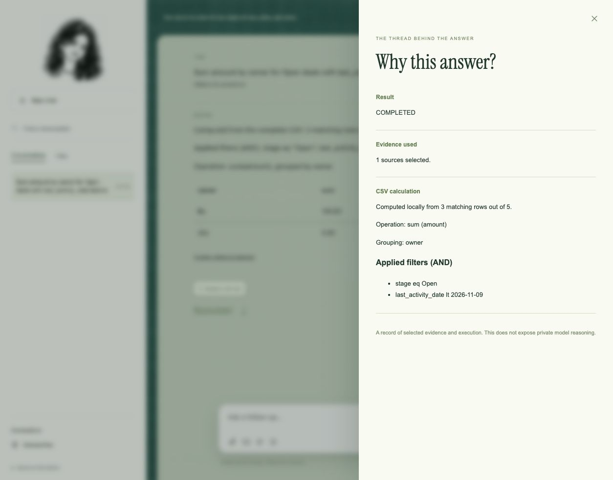

# Data handling hardening — 16 November 2026

This is a coding-agent-reviewed functional audit of the local working tree following `bc817f0`. It does not replace the historical 40-case supported-claim benchmark, measure production accuracy or certify every scan or analysis request.

## Changes and evidence

| Area | Delivered behavior | Fresh proof |
| --- | --- | --- |
| Dense images | Local English OCR retains small text alongside the visual description; readable OCR survives hosted-vision failure with an explicit non-text limitation. | A real 1800×2200 synthetic image with 45 lines retains the final `COBALT731` code while the external vision adapter returns HTTP429. Actual bundled Tesseract is used, not a fake OCR result. |
| Poor scans | Higher-resolution PDF rasterization, local contrast enhancement and a second segmentation pass. A sparse native text layer no longer hides the scanned image beneath it. | A low-contrast synthetic invoice PDF with a native `Scan` header extracts `ACME42` and `USD 4200` without a Groq key. Physical page markers and derived-text warnings remain. |
| Compound CSV analysis | Validated, bounded plans over the complete retained file: four AND filters, two grouping columns, sum/average/min/max/count, top rows and sorting. Arithmetic uses fixed-point decimals. | Eight public Turns tests include exact filtered sums, missing-value averages, negative-value sorting, top rows, invalid plans, locale-formatted values and mixed-currency refusal. Five additional live-model planning checks pass. |
| Provider quotas | Cross-question provider cooldown; bounded success-only image cache keyed by bytes/MIME/model. Local OCR and locally computed results reduce dependence on inference. | Provider tests prove a repeated successful image makes one HTTP dispatch, a different question cannot bypass Retry-After, and dispatch resumes after the cooldown. This does not establish a billing-credit or latency improvement. |
| Presentation | Semantic tables and an inspectable CSV computation section. | Browser upload of `examples/complex-crm.csv` returns Bo 100.50 / Alia 0.30, with both filters and 3 matching rows. At 375px, page width remains 375px and the table is 316px; no page-wide horizontal overflow. |

[Live CSV capture](data-hardening-2026-11-16/live-csv.json) includes the synthetic files, answers, cited sources, usage and applied plans. Expectations are independent known fixture values, not model self-grades. Five cases passed: filtered groups, missing-value average, top two rows, filtered count and mixed-currency refusal. These are narrow acceptance assertions, not a claim-support percentage.

The regression suite has **291 passing tests**. TypeScript, lint and production build are checked separately before handoff. External providers are substituted in deterministic tests; local image processing/OCR, SQLite and file handling are real. The live CSV runner calls the configured model. Browser checks use an isolated workspace with synthetic data, not the owner's private history.

## Reproduce

```sh
npm install
npm test
npm run check
npm run lint
npm run build
node --import tsx evaluations/data-hardening.ts --run-live
```

The final command requires the configured Groq key and consumes quota. No search key is needed for private-file calculations. The runner explicitly rejects attempts to search the web for its private CSV records. Try uploading `examples/complex-crm.csv` and asking:

> Sum amount by owner for Open deals with last_activity_date before 9 November 2026, largest first.

Then inspect **Why this answer? → CSV calculation**. The model proposes the plan; the application validates and executes it. A valid plan can still misunderstand a natural-language request, so its filters are visible for review.

## Limits that remain

Local OCR initially supports English. Handwriting, severe blur, unusual layouts, multilingual OCR and fine chart geometry are not solved universally. Image/scanned-page interpretations remain approximate and original files remain available for inspection. No preprocessing can recover information that is absent from an image.

The CSV plan language is not SQL. It does not support joins, OR/nested boolean expressions, forecasts or arbitrary formulas. It admits up to four AND filters, two grouping columns and twenty displayed rows; large result sets require narrower questions. Numeric locale/currency ambiguity is rejected, not guessed. Averages disclose rounding and blanks; empty numeric groups are not ranked as zero.

Provider limits remain external constraints. Cooldowns and caches are process-local, expired image interpretations are regenerated, and failed/cancelled interpretations are not cached. There is no silent provider switch, paid-overage enablement or quota bypass. Same-model planning and interpretation can still make semantic mistakes.

Design trade-offs and primary references are in [ADR 0002](../adr/0002-bounded-data-analysis-and-local-ocr.md). The prior multimodal audit and original failures remain unchanged.


