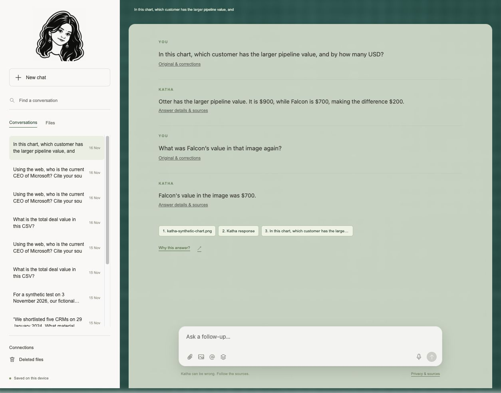

# Multimodal answer audit — 16 November 2026

Local working-tree audit, using the configured Groq model and synthetic fixtures. This is a coding-agent review, not independent certification, a full rerun of the 40-case claim-support benchmark, or proof that every possible question works. No deployment was performed. UTC captures begin on 15 November; the local review date is 16 November in Asia/Kolkata.

## Findings and repairs

1. **PDF contributor drift reproduced.** After an identity-based question about Alia, an explicit page 44 question, a switch to Bo, and a pronoun follow-up, “what were his findings?” incorrectly repeated Alia's limitation. The reference itself was already Bo; competing earlier assistant responses were still being passed as evidence. Resolved contributor questions now omit earlier generated answers from the baseline and explicitly carry the resolved reference into the model context. Original documents, user identity, reference provenance and deletion checks remain intact.
2. **Incomplete CSV answer reproduced.** The first live Tuesday attendance question failed because the provider omitted required answer fields. It now gets the same single bounded repair used for other answer-contract violations. A second malformed response fails closed. Repairs retain citation validation, accumulated usage, cancellation and quota controls; this is not a promise that model failures disappear.
3. **Unrelated source selection reproduced in the browser.** A correct chart answer displayed other chats' project reports and CSVs as selected evidence. Selected-file analysis now excludes unrelated workspace files and other chats' generated responses, retaining current-conversation context, explicit identity and relevant corrections. Explicit cross-file comparisons remain distinct. This reduces distraction and unnecessary context transmission; it is not a new authorization or security boundary.

All three have public Turns/Evidence Library regression coverage with real temporary SQLite/files. Earlier CSV-total and web-routing fixes are preserved.

## Fresh observations

| Path | Result | What was actually checked |
| --- | --- | --- |
| Text PDF | 6/6 reviewed answers correct after repair | A synthetic 45-page PDF: identity from another chat, physical page 44, named contributor switch, two pronoun follow-ups, and return to the original author. Bo's answer includes 240 ms on the local CPU and explicitly excludes production traffic. |
| CSV | 5/5 acceptance checks and factual review pass on the fresh rerun | 120 rows; exact decimal total 132.10; Customer120 value 120.20; Monday 40 present/20 absent; Tuesday 60 present/0 absent; recommendations separate suggestions from recorded facts and do not invent employees. |
| Image lifecycle | 5/5 live checks pass | Customer Falcon/USD 700, same-chat follow-up, new-chat recall after server restart, refusal after trash, recall after restoration. |
| Browser chart | Correct initial answer and restart follow-up | A synthetic chart shows Falcon 700 and Otter 900. Browser answer correctly identifies Otter and a USD 200 difference. After restart, the follow-up recalls Falcon at USD 700; its source list contains the image and current conversation, not unrelated files. |
| Scanned PDF | Interpretation passed after quota-clear retry | Raster-only one-page fixture: “Five seats. USD 20 per month.” Extraction is labelled `pdf-text-and-vision` with a model-interpretation warning. This checks extraction, not a separate generated-answer accuracy score. |
| Deterministic suite | 275 passed, zero failed | Includes dated CRM/Postgres/November 3 recall across restart, failed-search uncertainty, corrections/deletion, source selection, upload validation, arithmetic, invalid citations and bounded repair. These substitute external providers; they are distinct from live-model checks. Type checking, lint and production build also pass. |

The initial mixed attachment run remains **9/10**, not relabelled as perfect. The failed Tuesday case is preserved. Both PDF runs are preserved, including the incorrect original findings answer. The first scanned-PDF attempt was blocked by free-tier `RATE_LIMIT`; a later attempt after the wait succeeded. Do not erase these failures or combine successful cases into a claimed general accuracy percentage.

The fresh PDF and CSV captures precede the last selected-file isolation change; that change has deterministic regression coverage and the subsequent browser restart/follow-up check. No new overall claim-support percentage is assigned to this working tree.

## Evidence and reproduction

[Capture manifest and runtime hashes](multimodal-2026-11-16/manifest.json) · [initial attachment run](multimodal-2026-11-16/attachments-initial.json) · [CSV rerun](multimodal-2026-11-16/csv-after.json) · [PDF before](multimodal-2026-11-16/pdf-before.json) · [PDF after](multimodal-2026-11-16/pdf-after.json) · [scan extraction](multimodal-2026-11-16/scan-after.json).

The synthetic PDF and chart are retained beside the captures. Their names and performance figures are invented test fixtures, not Soumyajit's project outcomes. The manifest records the base commit and SHA-256 of the uncommitted runtime/test files; the base commit alone does not identify this revision. Screenshots are visual proof, not an accuracy score.

With the configured server keys, from the repo on Node 24:

```sh
npm test
npm run check
npm run lint
npm run build
node --import tsx evaluations/attachment-acceptance.ts --run-live
node --import tsx evaluations/pdf-page-followup.ts --run-live --pdf docs/evaluations/multimodal-2026-11-16/synthetic-contributors.pdf --name 'Alia Das' --person 'Bo'
node --import tsx tests/live-ingestion.ts --run-live
```

Live runs consume provider quota. The tests and build were run from an isolated dependency-installed copy of the same modified source files to avoid intermittent SSD I/O delays. Browser checks used the actual restarted localhost workspace. Keys were loaded from the existing local environment without being printed or copied into these captures.

## Limits that remain

- PDF support is bounded to 5 MB/50 pages; physical and printed page numbers can differ. Retrieval sends excerpts, not an entire large document in every answer.
- Scanned pages and images are model interpretations. Later image answers use retained descriptions; details omitted by the interpreter are not guaranteed to be recoverable. Dense charts, poor scans and handwriting need broader evaluation.
- CSV support does not mean arbitrary SQL, joins or unrestricted multi-condition analysis. Currency/locale ambiguity and incomplete numeric evidence must remain explicit. The deterministic total path is intentionally limited to unfiltered, named-column sums.
- Quotas, outages and model mistakes remain possible. One repair is a recovery mechanism, not a correctness guarantee.
- This audit did not reauthorize or live-test every external account connection, rerun all competitor/model comparisons, or perform physical-mobile testing. Prior connector deferrals remain unchanged.
- Historical release metrics remain pinned to their original run. These smaller functional checks do not update the published 93.7% support result.


